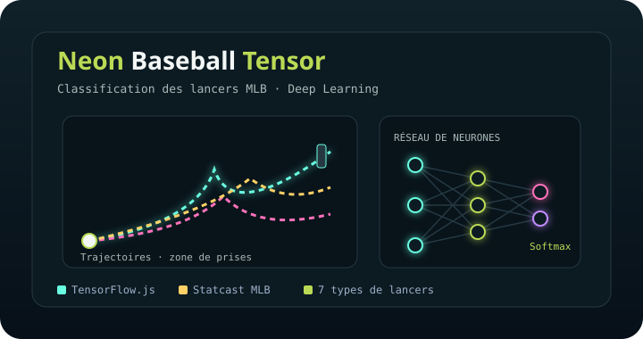

# Neon Baseball Tensor

[](https://github.com/kewinMarchand/tensor-lab/tree/main/apps/baseball)



Application pédagogique et interactive de **classification des lancers MLB** (données Statcast) par réseau de neurones avec **TensorFlow.js**.

## Démo en ligne (GitHub Pages + backend Render)

- [Ouvrir Neon Baseball Tensor](https://kewinmarchand.github.io/neon-baseball-tensor/)
- **Backend** : hébergé sur [Render](https://render.com) (`https://neon-baseball-tensor.onrender.com`).

> **Note** : GitHub Pages sert le frontend (statique). Le backend Node.js (`server.js`, Socket.IO) tourne sur Render (offre gratuite) pour les fonctionnalités serveur (entraînement/données selon configuration).
> - **Démarrage à froid** : après inactivité, le service peut mettre ~30 s à 1 min à se réveiller.
> - **Persistance** : stockage éphémère en offre gratuite (données/modèles peuvent être réinitialisés au redémarrage).
> - Pour l’expérience complète/stable, utilisez le lancement local.

## Lancer en local

Prérequis : Node.js + npm.

```bash
npm install
npm run dev
```

- Frontend (webpack-dev-server) : http://localhost:8080
- Backend (Socket.IO) : http://localhost:8001

Ouvrir http://localhost:8080 dans le navigateur.

## Fonctionnalités

- Entraînement d’un modèle de classification de types de lancers (ex. fastball, curveball, slider, changeup, etc.).
- Visualisation 3D/terrain et trajectoires, dictionnaire des variables Statcast.
- Interface d’inférence interactive et suivi de progression/époques.

## Thème

Thème **Boilerplate Neon** partagé (`neon/neon-tokens.css`, `neon-base.css`, `neon-components.css`) avec styles propres à l’application. Fait partie de la collection [Neon Tensor](https://github.com/kewinMarchand/tensor-lab).
