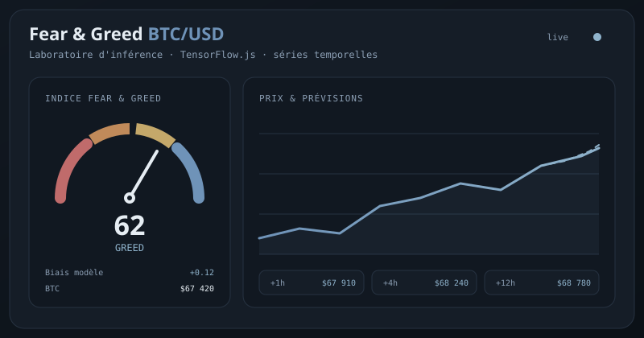

# Fear & Greed Tensor

[](https://github.com/kewinMarchand/tensor-lab/tree/main/apps/fear-greed)



Laboratoire d’inférence TensorFlow.js : indice **Fear & Greed** calculé en temps réel sur **BTC/USD**, avec modèles LSTM entraînés pas-à-pas (biais de direction et prévisions multi-horizons).

## Démo en ligne (GitHub Pages + backend Render)

- [Ouvrir l’app](https://kewinmarchand.github.io/tensor-lab/apps/fear-greed/)
- **Backend** : hébergé sur [Render](https://render.com) (`https://fear-greed-tensor.onrender.com`).

> **Note** : GitHub Pages sert le frontend (statique). Le backend Node.js (`server.js`, Socket.IO) tourne sur Render (offre gratuite) pour la collecte des données de marché, l’entraînement et les prédictions en temps réel.
> - **Démarrage à froid** : après inactivité, le service peut mettre ~30 s à 1 min à se réveiller.
> - **Persistance** : stockage éphémère en offre gratuite (données/modèles `data/` peuvent être réinitialisés au redémarrage) ; un historique versionné est embarqué pour un démarrage plus rapide.
> - Pour une utilisation complète/stable, lancez l’application en local.

## Lancer en local

Prérequis : Node.js + npm. Depuis ce dossier (`apps/fear-greed`) :

```bash
npm install
npm run dev
```

- Frontend (webpack-dev-server) : http://localhost:8082
- Backend (Socket.IO / collecte + entraînement) : http://localhost:8002

Ouvrir http://localhost:8082 dans le navigateur (ne pas ouvrir `index.html` en `file://`).

### Dépannage rapide
- Vérifier que `npm install` s’est terminé sans erreur et lancer `npm run dev` depuis le dossier du projet.
- Vérifier que les ports **8002** et **8082** sont libres.
- Attendre la compilation webpack (`compiled successfully`) et les logs backend (`Serveur ... port : 8002`).
- En cas de souci de dépendances, supprimer `node_modules` puis relancer `npm install`.

## Fonctionnalités

- **Indice Fear & Greed composite (0–100)** calculé côté serveur (momentum, tendance EMA, volatilité, volume, RSI, dominance BTC, biais du modèle).
- **Données de marché publiques** (Coinbase/Kraken/CoinGecko, sans clé API).
- **Modèles** : classifieur de direction et prévisionniste multi-horizons (+1 h, +4 h, +12 h, +7 j selon vues).
- **Interface** : graphiques horaire/journalier/hebdomadaire, entraînement, prédictions, suivi de progression.

## Thème

Thème **Graphite** (sombre, sobre, accent bleu acier) partagé (`neon/neon-tokens.css`, `neon/neon-base.css`, `neon/neon-components.css`) avec styles propres à l’application. Fait partie de la collection [Tensor Lab](https://github.com/kewinMarchand/tensor-lab).
